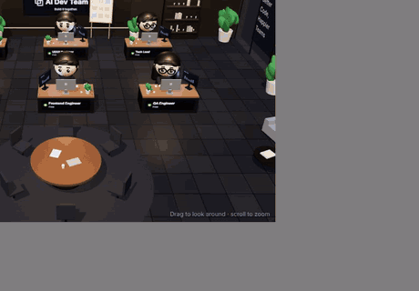
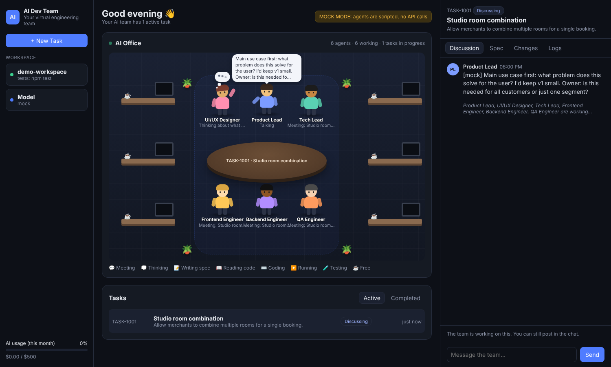

# AI Dev Team

Your own virtual engineering team, powered by Claude. Give it a task. Six role agents discuss it, you approve a spec, and then they code, test and fix it in your git repo until it's ready for you to review.



## The AI Office

The office at the top of the dashboard shows what each agent is doing, live:

| You see | It means |
|---|---|
| Agents walk to the meeting table, nod, speech bubbles pop up | Discussing a task (bubbles show what they just said in the chat) |
| 💭 Thought bubble | Waiting on Claude to decide what to say or do next |
| 📝 Typing, document on screen | Product Lead writing the spec |
| 📖 Code scrolling on screen | Reading or searching the code |
| ⌨️ Fast typing, colored code lines | Editing files |
| ⚙️ Terminal on screen | Running a command |
| 🧪 Progress bar and ✓ on screen | Running the tests |
| `…` at desk | Standing by while a teammate works |
| Short huddle at the table | Build kickoff, or QA walking the engineers through what failed |

Activity comes from what the agents are really doing: the app watches Claude's stream and sees which tool it's starting to use (for example `write_file public/rooms.html`), then shows the matching engineer at work. Paths that look like UI go to the Frontend Engineer, API/server/database paths to the Backend Engineer, and the rest to the Tech Lead.



## How it works

1. **New task.** You describe what you want.
2. **Discussion.** Product Lead, UI/UX Designer, Tech Lead, Frontend Engineer, Backend Engineer and QA Engineer each post their take from their own angle. In a second round they speak up only if they disagree or something is missing; otherwise they pass.
3. **Spec.** The Product Lead writes a spec (goal, scope, requirements, technical approach, edge cases, test plan). It also lists the **questions only you can answer**, each with an assumed default.
4. **You review.** Reply in the chat to change something (the spec gets revised), or click **Approve spec & build**.
5. **Build.** The engineers work on a new branch `ai/task-…` in your repo. They can list, read, search and edit files and run commands.
6. **QA.** Your test command runs, then the QA agent checks the diff against the spec and gives a PASS/FAIL verdict. On FAIL, the engineers get the report and fix it (up to 3 rounds by default).
7. **Your review.** The work is committed on the branch. See the diff in the **Changes** tab, then **Merge** it or **Reject** it (rejecting deletes the branch).

Nothing is pushed anywhere. Everything stays in your local repo.

## Quick start

Requires Node.js 22+ and git.

```bash
npm install
cp .env.example .env
```

Try it without an API key first (scripted fake agents on a small demo repo):

```bash
MOCK=1 npm start
```

Open http://localhost:3000.

Then use it for real. Edit `.env`:

```
ANTHROPIC_API_KEY=sk-ant-...
WORKSPACE_DIR=/absolute/path/to/your/project
TEST_COMMAND=npm test
```

and run `npm start`. If you leave `WORKSPACE_DIR` empty, the team works on a demo repo in `data/demo-workspace`.

Your repo must have **no uncommitted changes** when a build starts, and git needs your `user.name`/`user.email` configured.

## Tips

- Put your project's conventions in an `AGENTS.md` or `CLAUDE.md` at the repo root. Every agent reads it, along with `README.md` and the file list.
- A good `TEST_COMMAND` matters a lot. QA can only be as strict as your tests.
- The usage meter in the sidebar estimates spend from token counts. Set `MONTHLY_BUDGET_USD` to your own budget.
- To keep costs down on small tasks, set `MODEL=claude-sonnet-5-5` in `.env`.

## Safety

The agents run shell commands in `WORKSPACE_DIR` with your user's permissions. Guard rails:

- File tools can't leave the repo or touch `.git`.
- Agents can't commit, push, checkout or reset; the app does that itself.
- QA gets read-only file tools.
- Commands time out after 5 minutes.
- The server only listens on `127.0.0.1`. Don't expose it to the internet.

Still, only point it at a repo you've backed up or pushed, and review every diff before merging.

## Project layout

```
src/
  server.ts     HTTP API + live updates (Server-Sent Events)
  pipeline.ts   discussion → spec → build → QA → fix loop → review
  agents.ts     the six roles and their prompts
  llm.ts        Claude API calls, refusal fallback, usage tracking
  tools.ts      file/search/command tools the agents use
  workspace.ts  git helpers, project context, demo repo
  store.ts      tasks and state, saved to data/db.json
  mock.ts       scripted agents for MOCK=1
public/         the dashboard (plain HTML/CSS/JS, no build step)
```

## Configuration

| Variable | Default | |
|---|---|---|
| `ANTHROPIC_API_KEY` | – | Your API key |
| `WORKSPACE_DIR` | demo repo | Git repo the team works on |
| `TEST_COMMAND` | – (`npm test` for demo) | Run by QA after each build |
| `MODEL` | `claude-opus-5-5` | Model for all agents |
| `MAX_FIX_ROUNDS` | `3` | QA → engineer fix loops before handing over anyway |
| `MAX_AGENT_STEPS` | `60` | Tool calls per coding/QA session |
| `MONTHLY_BUDGET_USD` | `500` | For the usage meter |
| `PORT` / `HOST` | `3000` / `127.0.0.1` | Where the dashboard listens |
| `MOCK` | `0` | `1` = fake agents, no API calls |
